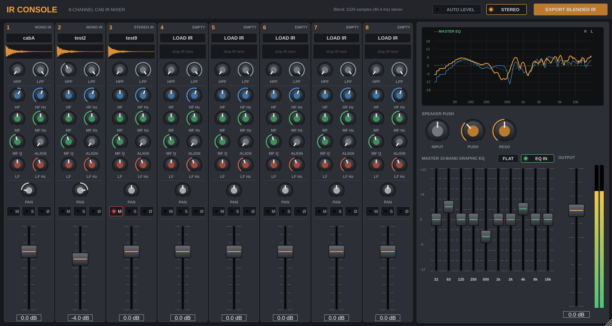

# IR Console



An 8-channel speaker cabinet IR mixer laid out like a mixing console. Load an impulse response on each channel, blend them with per-channel EQ, pan and volume, run the result through Speaker Push and a 10-band master graphic EQ, and export the blend as a WAV for this plugin, your DAW, or hardware such as a Line 6 Helix or Neural DSP Quad Cortex.

Formats: **VST3**, **AU** (macOS) and **Standalone**. Built with JUCE 8.

## Signal flow

```
Input → Input gain → SPEAKER PUSH → [ blended IR of channels 1–8 ] → MASTER GRAPHIC EQ → Output
                                     each channel: IR → Align → Polarity → HPF/LPF → LF/MF/HF EQ → Fader → Pan
```

All 8 channels are rendered into **one** blended IR in a background thread, and that IR is convolved in real time. Export uses the same render function, so the exported file sounds the same as what you hear in the plugin.

## Controls

**Channel strip (x8)**
| Control | Range | Notes |
|---|---|---|
| LOAD IR | WAV / AIFF / FLAC, mono or stereo, any sample rate | Click, or drag a file onto the strip. Click a loaded IR for Load / Clear / Reset. IRs are resampled with a windowed-sinc resampler. |
| HPF / LPF | 20 Hz–1 kHz / 1–20 kHz | 12 dB/oct. Fully counter-clockwise (HPF) or clockwise (LPF) means off. |
| HF | ±15 dB shelf, 1.5–16 kHz | |
| MF | ±15 dB bell, 200 Hz–8 kHz, Q 0.3–6 | |
| LF | ±15 dB shelf, 40–600 Hz | |
| ALIGN | 0–5 ms | Time-aligns mics, e.g. a ribbon a few inches behind a dynamic. |
| Ø | polarity flip | |
| PAN | L100–C–R100 | Constant-power pan for mono IRs. Acts as a balance control for stereo IRs. |
| M / S | mute / solo | |
| Fader | −inf to +12 dB | |

Double-click any control to reset it.

**Master section**
- **MONO / STEREO**: switches the whole console. Mono sums every channel and ignores pan, and the output is identical on L and R.
- **AUTO LEVEL**: normalises the energy of the blend, so the level stays consistent however many IRs you stack. Turn it off to use the channel faders as absolute levels.
- **SPEAKER PUSH**: simulates the speaker being driven hard, before the cab IR. As PUSH goes up you get:
  - voice-coil power compression
  - a low-end cone resonance bloom, with **RESO** setting its frequency (40–250 Hz)
  - upper-mid cone breakup
  - asymmetric cone-excursion saturation

  It runs 2x oversampled with linear-phase filters, adding 49 samples of latency, which the plugin reports to the host.
- **MASTER 10-BAND GRAPHIC EQ**: a 560-style graphic EQ. Bands are at 31, 63, 125, 250, 500, 1k, 2k, 4k, 8k and 16k, each ±12 dB. Q is proportional, so bands are broad at small settings and tighten as you push them. **FLAT** resets all bands and **EQ IN** bypasses the EQ.
- **Response display**: shows the frequency response of the blended IR (L and R), plus the master EQ.

## Exporting

Click **EXPORT BLENDED IR**, then pick a target:

| Preset | Format |
|---|---|
| Line 6 Helix / HX | 48 kHz, 16-bit, mono, 2048 samples (Helix's native IR format) |
| Neural DSP Quad Cortex | 48 kHz, 24-bit, mono, 1024 samples |
| Generic hardware | 48 kHz, 24-bit, mono, 2048 samples |
| IR Console / DAW stereo | 48 kHz, 32-bit float, stereo, full length |
| IR Console / DAW mono | 48 kHz, 24-bit, mono, full length |

You can also choose your own channels (mono or stereo), sample rate (44.1, 48 or 96 kHz), bit depth (16, 24 or 32-bit float) and length (1024, 2048, 4096 or 8192 samples, 500 ms, or full). Options:
- **Include master EQ**: bakes the graphic EQ into the IR.
- **Normalise**: sets the peak to −0.1 dBFS.

When an IR is shortened, its tail gets a short fade so there is no click at the cut.

What can't go into the export:
- **Speaker Push** is non-linear. No IR can capture it, so it is never in the exported file.
- **Input and output gain** are live level controls, not part of the IR.

Hardware notes:
- **Helix**: Helix uses only the left channel of a stereo file, so export mono. Import through HX Edit or Helix Native's IR tab.
- **Quad Cortex**: users report that the QC uses only the first 1024 samples. Check this against your firmware, and pick a longer length if your firmware supports it. Import through Cortex Control.

An exported blend loads back into any channel of IR Console, so you can stack blends of blends.

## Building

Requirements: CMake 3.22+ and a C++17 compiler (Xcode, Visual Studio 2022, or GCC/Clang). If there's no `JUCE/` folder next to `CMakeLists.txt`, CMake downloads JUCE 8.0.9 automatically.

```bash
cmake -B build -DCMAKE_BUILD_TYPE=Release
cmake --build build --config Release --parallel
```

On macOS, add `-DCMAKE_OSX_ARCHITECTURES="arm64;x86_64"` to the first command for a universal binary. On Linux, first install `libasound2-dev libx11-dev libxrandr-dev libxinerama-dev libxcursor-dev libxext-dev libfreetype-dev libfontconfig1-dev libgl1-mesa-dev`.

Build output goes to `build/IRConsole_artefacts/Release/`. Copy the plugin to its standard folder:
- **macOS**: `~/Library/Audio/Plug-Ins/VST3` and `~/Library/Audio/Plug-Ins/Components` (AU)
- **Windows**: `C:\Program Files\Common Files\VST3`
- **Linux**: `~/.vst3`

**Pre-built binaries without a local toolchain:** push this folder to a GitHub repository. The included workflow (`.github/workflows/build.yml`) builds macOS (universal), Windows and Linux binaries and attaches them as downloadable artifacts on each run.

The macOS build is not code-signed. If macOS blocks it, run:

```bash
xattr -dr com.apple.quarantine "/path/to/IR Console.vst3"
```

**Tests:** configure with `-DIRC_BUILD_TESTS=ON` and run `IRConsoleTests`. It checks:
- the blend maths (pan, polarity, mute/solo, align, EQ, auto level)
- resampling
- the Helix, QC and stereo export formats
- that the real-time output matches the exported blend
- state recall, with IRs embedded in the session
- UI rendering

## Session recall

IR audio is embedded in the plugin state, so sessions recall correctly even if the original IR files are moved or deleted.
